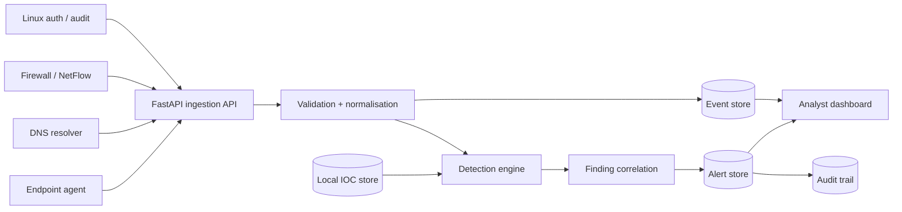

# AegisNet SOC

**An explainable, event-driven Security Operations Centre prototype for multi-source telemetry.**

AegisNet ingests endpoint, authentication, DNS, firewall and network events; normalises them into a common schema; evaluates transparent detection rules; correlates evidence into alerts; and gives analysts an auditable workflow to investigate, contain and resolve incidents.

> **Recruitment context:** This independent portfolio project was designed to demonstrate skills relevant to product engineering and sustenance work in cybersecurity platforms: backend/API engineering, event processing, detection logic, data modelling, operational workflows, testing, documentation and deployment. It is not affiliated with, endorsed by, or a replica of C-DOT or any C-DOT product. The detection rules and datasets are original demonstration material.

   

## Why this project is relevant to C-DOT

C-DOT’s current openings page lists the **Young Professionals – Product Engineering & Sustenance** position, with a closing date of **8 November 2026 at 5:00 PM**. C-DOT’s public TRINETRA product page describes a centralized cybersecurity platform spanning capabilities such as endpoint monitoring, SIEM, SOAR, UEBA, DLP, audit/compliance and ingestion of logs, syslog and network traffic. AegisNet is an independent portfolio demonstration of a subset of the engineering problems behind that class of system: reliable telemetry ingestion, explainable detections, evidence correlation, threat-intelligence enrichment and analyst-facing incident workflows.

References: [C-DOT current openings](https://cdot.in/cdotweb/web/current_openings.php?lang=en) · [C-DOT TRINETRA product description](https://www.cdot.in/cdotweb/web/product_page.php?catId=4&lang=en&pId=77)

## What it demonstrates

| Engineering area | Implementation |
|---|---|
| Multi-source telemetry | Versioned batch-ingestion API with schema validation and canonical event records |
| Product reliability | Idempotent ingestion, bounded batches, indexed queries and explicit status transitions |
| Detection engineering | Six deterministic rules with thresholds, time windows, risk scores and evidence references |
| Threat intelligence | Offline IP/domain/SHA-256 indicator store; exact-match enrichment |
| Incident response | Analyst queue, investigation notes, assignment, containment and resolution workflow |
| Accountability | Append-only audit entries for alert creation, status changes and re-opening |
| Interoperability | MITRE ATT&CK technique/tactic references in detection records |
| Operability | Health endpoint, structured log messages, Docker, Compose and GitHub Actions CI |

## Dashboard

The local dashboard presents telemetry volume, active alert severity, a searchable alert queue, recent event stream, detection coverage and local indicators. Select an alert to inspect its evidence timeline and audit history, then update its status.

## Detection catalogue

| Rule | Detection | Demonstration condition | ATT&CK reference |
|---|---|---|---|
| `AUTH-001` | Authentication brute force | 5 or more failed authentication events from one source IP within 5 minutes | T1110 — Brute Force |
| `NET-001` | Port-scan behaviour | 8 or more distinct destination ports from one source IP within 60 seconds | T1046 — Network Service Discovery |
| `THREAT-001` | IOC match | Source/destination IP, queried domain or SHA-256 hash matches a local IOC | T1105 / T1071 |
| `EXFIL-001` | Large outbound transfer | One event reports at least 10 MiB of outbound data | T1567 — Exfiltration Over Web Service |
| `EDR-001` | Privileged endpoint execution | Successful privileged action (`sudo`, `runas`, etc.) in endpoint telemetry | T1548.003 — Sudo and Sudo Caching |
| `DNS-001` | High-entropy DNS query | First domain label is at least 28 characters and entropy is at least 3.6 bits/character | T1568.002 — Domain Generation Algorithms |

These are deliberately small, readable baseline rules. Thresholds are configurable in code and are not claimed to be production-calibrated. Real environments require asset criticality, allow-lists, baselining, rule tuning and analyst feedback.

## Quick start

Requires Python 3.11 or later.

```bash
# 1. Clone the repository
 git clone https://github.com/<your-username>/aegisnet-soc.git
 cd aegisnet-soc

# 2. Create and activate a virtual environment
python -m venv .venv
# Linux / macOS:
source .venv/bin/activate
# Windows PowerShell:
# .venv\Scripts\Activate.ps1

# 3. Install the project
python -m pip install -e ".[dev]"

# 4. Start the local service
uvicorn aegisnet.main:app --reload
```

Open **http://127.0.0.1:8000**. Click **Run demo simulation** to ingest synthetic telemetry and generate detections. Interactive API documentation is available at **http://127.0.0.1:8000/api/docs**.

The demo uses documentation-only IP ranges (RFC 5737) and the reserved `.invalid` domain. It does not scan networks, execute endpoint commands, contact external threat feeds or perform containment actions.

### Docker

```bash
docker compose up --build
```

The dashboard is exposed on port `8000`; the SQLite database is persisted in a named Docker volume.

## API overview

| Method | Endpoint | Purpose |
|---|---|---|
| `GET` | `/healthz` | Liveness check |
| `GET` | `/api/v1/overview` | KPI totals, 24-hour event trend and severity counts |
| `GET` | `/api/v1/alerts` | Filterable alert queue (`status`, `severity`, `limit`) |
| `GET` | `/api/v1/alerts/{id}` | Alert detail, evidence and audit timeline |
| `PATCH` | `/api/v1/alerts/{id}` | Analyst status/assignee/note update |
| `GET` | `/api/v1/events` | Recent normalised telemetry |
| `POST` | `/api/v1/events/batch` | Ingest 1–500 events and run detections |
| `GET` | `/api/v1/iocs` | List local threat indicators |
| `POST` | `/api/v1/iocs` | Add an IP, domain or SHA-256 indicator |
| `POST` | `/api/v1/demo/replay` | Replay bundled synthetic events with current timestamps |

### Ingestion example

```bash
curl -X POST http://127.0.0.1:8000/api/v1/events/batch \
  -H 'Content-Type: application/json' \
  -d '{"events":[
    {"event_id":"auth-demo-001","event_type":"auth","source":"linux-auth",
     "timestamp":"2026-11-05T16:00:00Z","src_ip":"203.0.113.45",
     "asset":"edge-gateway-01","username":"root","action":"login","outcome":"failure"}
  ]}'
```

`event_id` is the source's stable event identifier. Re-sending the same ID is treated as a duplicate. If an event ID is omitted, AegisNet derives a SHA-256 idempotency key from the canonical event payload.

### Optional write API key

Set `AEGIS_API_KEY` to require the `X-API-Key` header on write operations (`POST` and `PATCH`). Example:

```bash
export AEGIS_API_KEY='replace-with-a-long-random-secret'
uvicorn aegisnet.main:app
```

The default local demo leaves the key unset so the dashboard can run out of the box. When a key is configured, use the dashboard **Key** control to set it for the current browser tab (it is held in `sessionStorage`, not persisted across browser sessions). Do not expose this development configuration to the public internet. For a shared deployment, place the service behind TLS and an authenticated reverse proxy, configure a secret, and use a production database and migration process.

## Architecture



**Processing sequence:** validate event envelope → canonicalise event ID → reject duplicate → persist event → evaluate bounded rules against the relevant time window → upsert correlated alert → append audit record when an alert is created or reopened → commit transaction.

## Repository layout

```text
src/aegisnet/
  config.py          Environment-based configuration
  database.py        SQLAlchemy engine and session dependency
  models.py          Event, Alert, IOC and AuditEntry models
  schemas.py         Strict API input contracts
  detection.py       Explainable detection rules and correlation
  service.py         Ingestion, serialization and IOC seeding
  main.py            FastAPI routes, dashboard and security headers
  static/            Responsive dashboard (HTML/CSS/vanilla JS)
data/
  demo_events.jsonl  Synthetic multi-source security telemetry
tests/               Unit tests for rules, validation and idempotency
docs/                Architecture, threat model, roadmap and interview guide
.github/workflows/   CI: Ruff + pytest
```

## Engineering decisions

- **Event IDs and idempotency:** stable upstream IDs are preferred; canonical payload hashing is a fallback. This avoids duplicate processing on retries.
- **Bounded windows:** rules query only the relevant source/time range, rather than scanning the full event history for every event.
- **Explainable alerts:** each alert stores the rule ID, threshold description, score, ATT&CK reference and a bounded evidence list.
- **Human-in-the-loop workflow:** detections never execute destructive actions. Analysts record status transitions and notes; illegal transitions are rejected.
- **Offline-first demo:** IOC data is local and reserved for documentation. The project is deterministic and works without API keys or internet access after installation.
- **Database portability:** SQLAlchemy models use SQLite by default for easy evaluation and can be pointed at PostgreSQL through `AEGIS_DATABASE_URL`.

## Test and quality checks

```bash
pytest
ruff check src tests
```

The tests cover brute-force and port-scan thresholds, IOC enrichment, outbound-transfer and endpoint/DNS detections, input validation and duplicate ingestion. GitHub Actions runs lint and tests for pushes and pull requests.

## Demo walkthrough (for a recruiter or technical interviewer)

1. Start the service and open the dashboard.
2. Run the demo simulation; note the event and alert counts.
3. Open the brute-force alert and show the five failed login records behind it.
4. Open the port-scan alert; explain the rolling 60-second distinct-port threshold.
5. Inspect the IOC match and show how local intelligence adds context without an external dependency.
6. Move an alert from **Open → Investigating → Contained** and add a note. Show the audit trail.
7. Open `/api/docs` and demonstrate the ingestion contract and health endpoint.

## Limitations and next engineering steps

This is a focused portfolio-scale prototype, not a production SIEM/EDR. It does not include a distributed message broker, multi-tenant isolation, RBAC, TLS termination, secret rotation, retention policies, schema migrations, high-availability storage or production-grade ML. The current entropy and threshold rules can produce false positives. The next steps are documented in [`docs/roadmap.md`](docs/roadmap.md).

## License

MIT. See [`LICENSE`](LICENSE).
